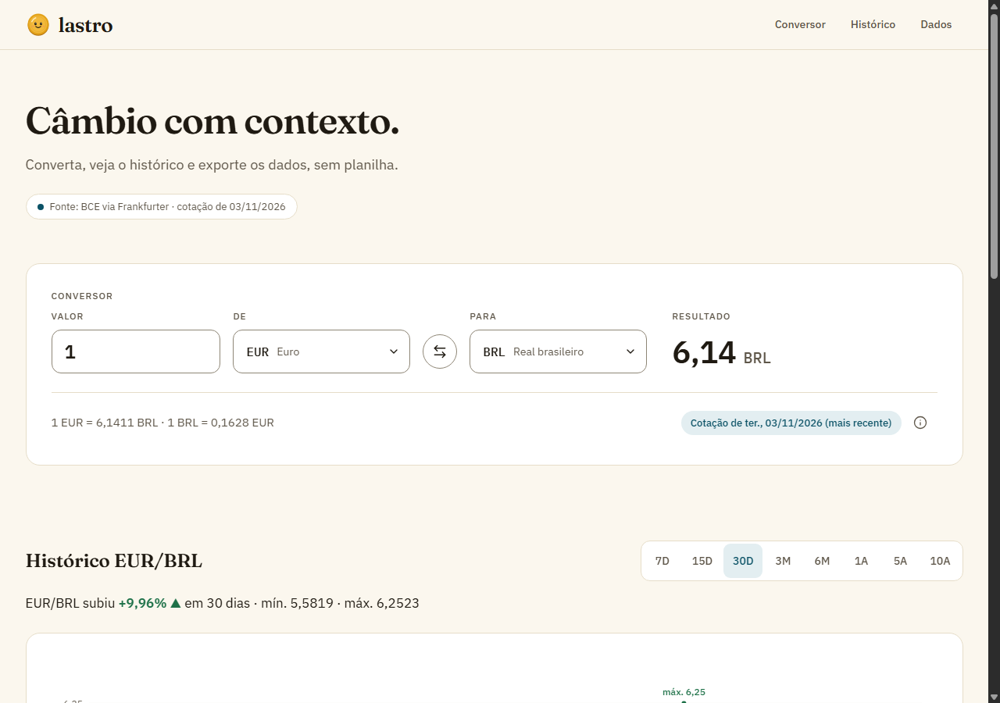
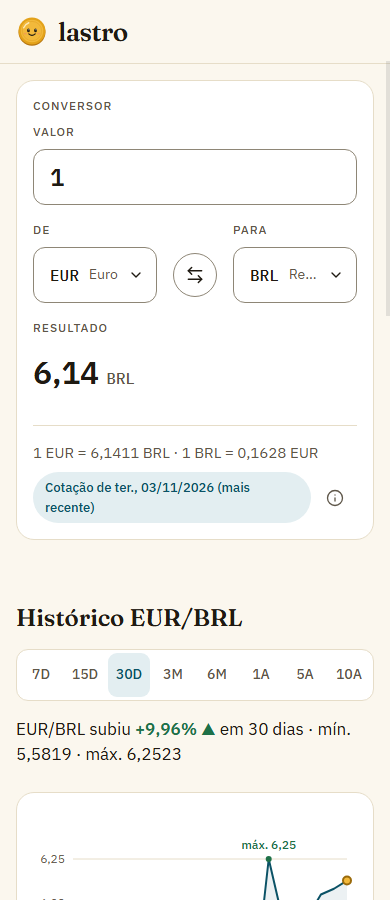
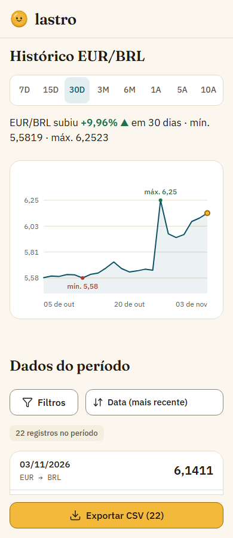
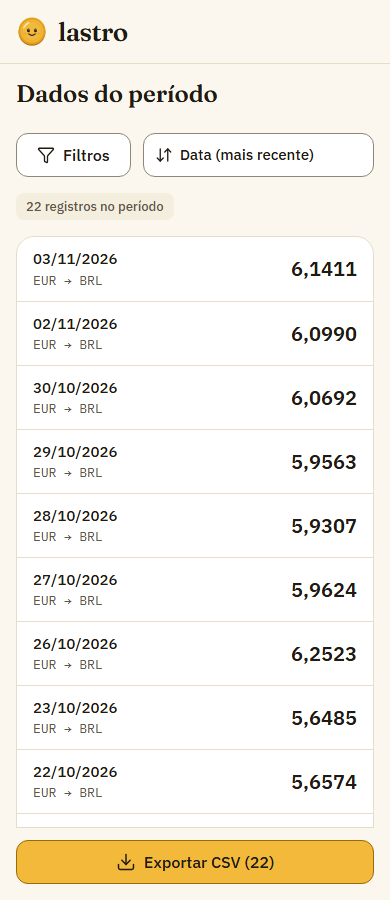
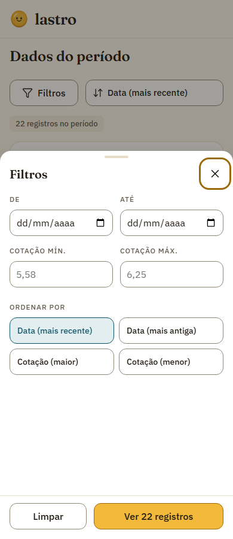
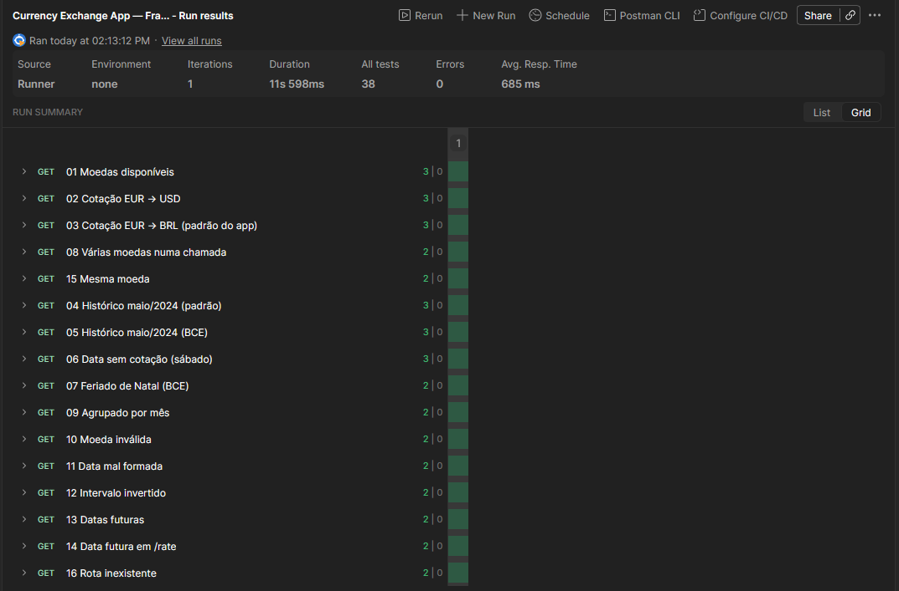

# Lastro · Currency Exchange App

SPA em React para **converter moedas**, acompanhar o **histórico de cotações** em gráfico e tabela, **filtrar e ordenar** os registros e **exportar os dados filtrados em CSV**. Os dados vêm da [API Frankfurter](https://frankfurter.dev/) (Banco Central Europeu).

Projeto 01 do curso de front-end: o briefing pede uma ferramenta que substitua a rotina de consultar vários sites, converter na mão e copiar valores para planilhas.

**Acesse online:** https://guzzkj.github.io/currency-exchange-app/



| Celular · conversor | Celular · histórico | Celular · dados | Celular · filtros |
|---|---|---|---|
|  |  |  |  |

## Funcionalidades

**Conversor**
- Moeda de origem e destino com busca por código ou nome (30 moedas ativas do BCE, nomes em português).
- Conversão enquanto se digita, aceitando `1.234,56` ou `1234.56`.
- Cotação direta e inversa, com a **data efetiva**. Nos fins de semana e feriados vale a última cotação publicada.
- Botão de inverter as moedas (mantém o valor digitado).
- Validação: valor vazio, zero, negativo ou texto mostra a mensagem e o resultado "—".

**Histórico e gráfico**
- Os 8 períodos: **7D · 15D · 30D · 3M · 6M · 1A · 5A · 10A**.
- Resumo do período (variação, mínima e máxima).
- Gráfico de área com marcas de mínima e máxima, tooltip no mouse e no teclado (setas) e descrição para leitor de tela.
- O gráfico atualiza ao trocar o par ou o período.

**Tabela de dados**
- Colunas Data · De · Para · Cotação, com os mesmos registros do gráfico.
- Filtros por intervalo de datas e por cotação mínima e máxima, combináveis, com "Limpar filtros".
- Ordenação por data ou por cotação, nas duas direções.
- Contador de registros ("2 filtros ativos · 5 de 22 registros") e paginação de 50 linhas.
- No celular: lista em cartões com "Carregar mais", e filtros e ordem num painel que sobe da parte de baixo da tela.

**Exportação CSV**
- Baixa **exatamente** os registros filtrados, na ordem da tabela, com cabeçalho `data;origem;destino;cotacao`.
- Separador `;`, vírgula decimal e BOM UTF-8, para o Excel em português abrir certo.
- Nome identificável: `cotacoes_EUR-BRL_2026-10-05_2026-11-03.csv`.
- Com 0 registros o botão fica desabilitado e explica o motivo.

**Estados**
- Loading com placeholders (skeletons), erro com "Tentar de novo" por parte da tela, ausência de dados e filtro sem resultado.

## Tecnologias

| Tecnologia | Uso |
|---|---|
| [React 19](https://react.dev/) + JSX | Interface em componentes de função, hooks |
| [Vite 7](https://vite.dev/) | Servidor de desenvolvimento e build |
| CSS Modules | Um `.module.css` por componente, tokens em `src/styles/tokens.css` |
| [Recharts 3](https://recharts.org/) | Gráfico do histórico (carregado sob demanda) |
| [lucide-react](https://lucide.dev/) | Ícones |
| [API Frankfurter v2](https://frankfurter.dev/) | Moedas, cotação atual e histórico, com `providers=ECB` |
| `node:test` | Testes das funções, sem dependência extra |
| Postman / Newman | Investigação e testes da API |
| ESLint | Padrão de código (regras de hooks do React) |

## Instalação e execução

Requisitos: **Node.js 20.19+ ou 22.12+** (exigência do Vite 7) e npm. Não precisa de chave de API nem de `.env`.

```bash
git clone https://github.com/guzzkj/currency-exchange-app.git
cd currency-exchange-app
npm install
npm run dev
```

Acesse `http://localhost:5173`.

### Scripts

| Comando | O que faz |
|---|---|
| `npm run dev` | Servidor de desenvolvimento com recarga automática |
| `npm run build` | Gera a versão de produção em `dist/` |
| `npm run preview` | Serve a versão de `dist/` (rode `build` antes) |
| `npm test` | Testes das funções JavaScript (72 testes) |
| `npm run lint` | ESLint |
| `npm run test:scenarios` | Os 15 cenários do briefing num Chrome de verdade (precisa do `preview` rodando na porta 4173, ver [testes finais](docs/FUNCTION_TESTS.md#testes-finais-na-tela-cartão-15)) |

### Publicação (GitHub Pages)

Cada push na `main` roda o workflow `.github/workflows/deploy.yml`: `npm ci`, `npm test`, build com `BASE_PATH=/currency-exchange-app/` e publicação no GitHub Pages. Localmente o `BASE_PATH` não existe, e o app continua na raiz (`/`).

## Arquitetura

```
src/
├─ App.jsx              estado compartilhado: par de moedas e período
├─ components/          20 componentes, cada um com seu .module.css
│  ├─ Header · Hero · Footer · Splash · StatusMessage
│  ├─ Converter         AmountInput · CurrencySelect · SwapButton · ConversionResult · RateInfo
│  ├─ HistorySection    PeriodSelector · HistoryChart
│  └─ DataSection       TableFilters · DataTable · DataList · FilterSheet · ExportCsvButton
├─ hooks/               useApiRequest (genérico) · useCurrencies · useLatestRate · useHistory · useMediaQuery
├─ services/            frankfurterApi.js: fetch, async/await e erros da API em um só lugar
├─ utils/               regras de negócio em funções puras, com testes (*.test.js)
├─ constants/           períodos, valores padrão, opções de ordem
└─ styles/              tokens.css (cores, espaços, fontes) · shared.module.css
```

**Fluxo de dados (lifting state up).** O `App` guarda o par e o período, porque conversor, histórico e tabela dependem deles. Os hooks buscam os dados na API e devolvem `{ status, data, retry }`. O `DataSection` guarda os filtros, a ordem e a página. A lista filtrada e ordenada é calculada a cada render e alimenta a tabela, o contador e o CSV ao mesmo tempo.

```
App (base, quote, period)
 ├─ useCurrencies · useLatestRate · useHistory  ──►  services/frankfurterApi
 ├─ Converter (valor digitado)        ◄── rate
 ├─ HistorySection                    ◄── history
 └─ DataSection (filtros, ordem, página)  ◄── history
       └─ filter + sort ─► DataTable / DataList · contador · ExportCsvButton
```

**Decisões principais**
- **Só o BCE** (`providers=ECB`): a v2 da API mistura fontes e devolve fins de semana. O BCE publica só em dias úteis, e conversor e histórico ficam com a mesma data efetiva ([API_TESTS.md](docs/API_TESTS.md)).
- **Regras fora dos componentes:** conversão, validação, períodos, filtros, ordenação e CSV ficam em `src/utils/`, testadas sem navegador ([FUNCTION_TESTS.md](docs/FUNCTION_TESTS.md)).
- **Requisições canceláveis:** `AbortController` em cada troca de par ou período, e resposta atrasada não sobrescreve a nova.
- **Estado derivado:** erros de filtro, lista filtrada e status de loading são calculados, não guardados.
- **Gráfico sob demanda:** `React.lazy` deixa o JS inicial em ~270 kB (86 kB gzip). O Recharts vem depois, num arquivo separado.

Detalhes de cada componente (props, estado, relação entre eles) em [COMPONENTS.md](docs/COMPONENTS.md).

## Testes

- **Funções:** 72 testes com `npm test`. Conversão, validação do valor, períodos e fuso horário, filtros, ordenação, CSV, camada da API e hooks.
- **API no Postman:** 16 requisições e 38 asserções, todas passando. Collection em `docs/postman/` e prints em `docs/postman/img/`.
- **Tela:** os 15 testes mínimos do briefing rodam no Chrome com a API real, com 96 verificações ok e 25 prints em `docs/img/tests/`.



## Documentação

| Documento | Conteúdo |
|---|---|
| [REQUIREMENTS.md](docs/REQUIREMENTS.md) | Contexto, escopo, requisitos funcionais e não funcionais, regras de negócio (RN01–RN15), critérios de aceite |
| [FIGMA.md](docs/FIGMA.md) | Link e evidências dos protótipos (baixa e média fidelidade, desktop e mobile, estados) |
| [COMPONENTS.md](docs/COMPONENTS.md) | Arquitetura, responsabilidade, props e estado de cada componente |
| [API_TESTS.md](docs/API_TESTS.md) | Investigação da API no Postman, erros e casos de borda |
| [FUNCTION_TESTS.md](docs/FUNCTION_TESTS.md) | Testes das funções e testes finais na tela |
| [AI_USAGE.md](docs/AI_USAGE.md) | Registro do uso de IA no projeto |
| [Collection Postman](docs/postman/currency-exchange.postman_collection.json) | Collection exportada em JSON |

**Figma:** https://www.figma.com/design/UiMsVBnNP7hYbxMpcS9Hp9

## Fonte dos dados

Cotações de referência do [Banco Central Europeu](https://www.ecb.europa.eu/stats/policy_and_exchange_rates/euro_reference_exchange_rates/html/index.en.html), via [Frankfurter](https://frankfurter.dev/). São publicadas uma vez por dia útil, por volta das 16h de Frankfurt. Não servem para operação em tempo real.
