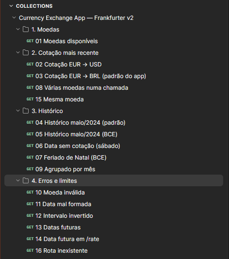
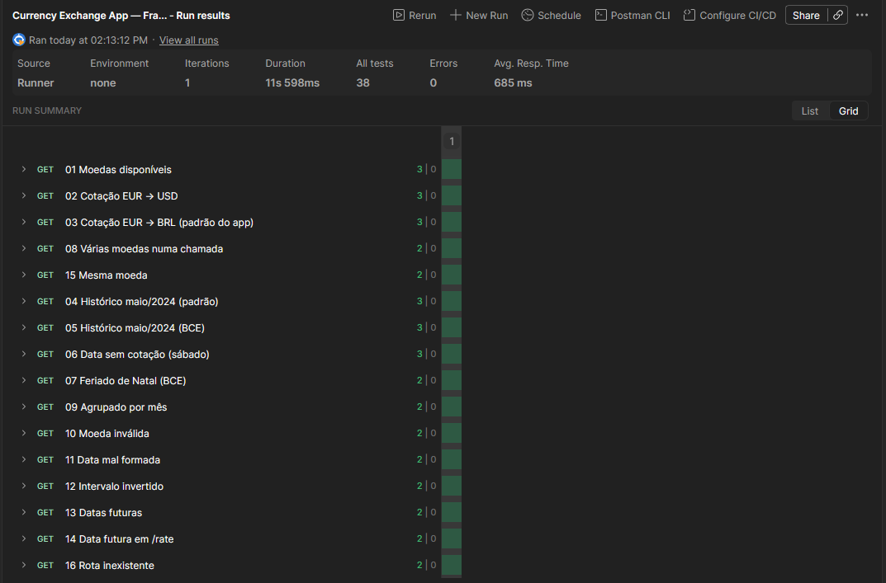
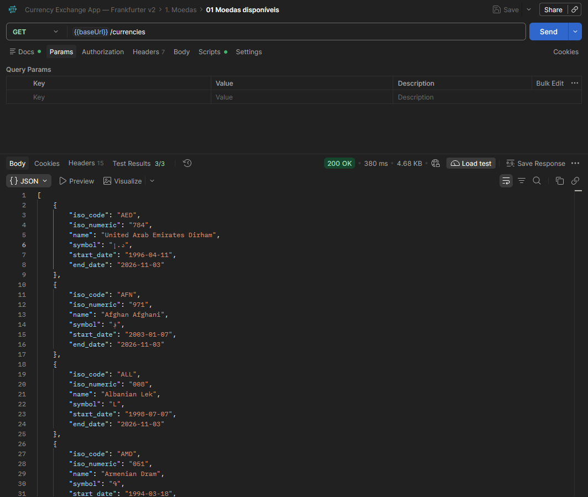
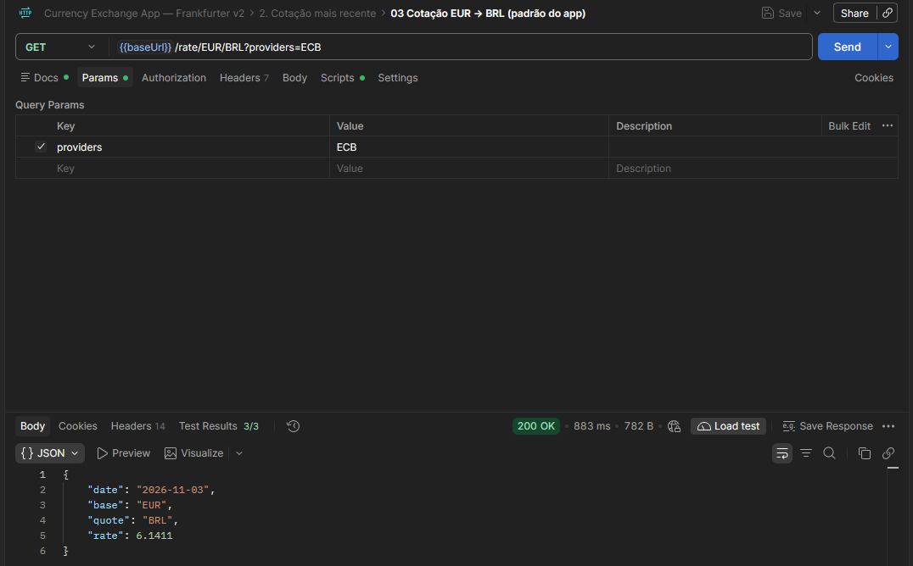
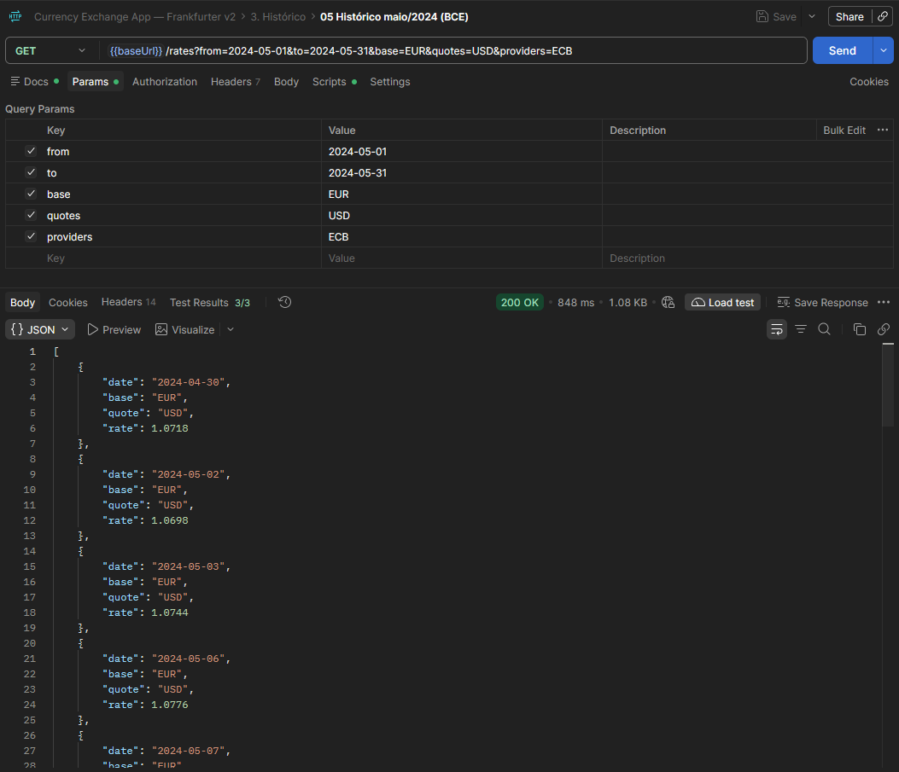
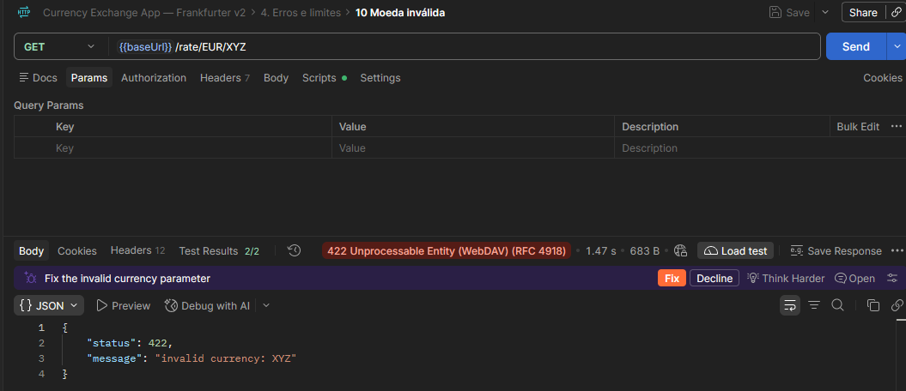

# Testes da API — Frankfurter v2

Investigação feita **antes** de integrar a API no React (cartão 7).
Ferramenta: **Postman**. A Collection exportada está em [`docs/postman/currency-exchange.postman_collection.json`](postman/currency-exchange.postman_collection.json).

- Documentação oficial: https://frankfurter.dev/
- URL base: `https://api.frankfurter.dev/v2` (variável `{{baseUrl}}` na Collection)
- Autenticação: nenhuma (API pública e gratuita)
- Data dos testes: 03/11/2026

## 1. Resumo

| # | Requisição | Status | Resultado |
|---|---|---|---|
| 01 | `GET /currencies` | 200 | Lista com 170 moedas |
| 02 | `GET /rate/EUR/USD` | 200 | Cotação mais recente de um par |
| 03 | `GET /rate/EUR/BRL` | 200 | Par padrão do app (RN05) |
| 04 | `GET /rates?from=2024-05-01&to=2024-05-31&base=EUR&quotes=USD` | 200 | Histórico por intervalo |
| 05 | `GET /rates?...&providers=ECB` | 200 | Histórico só com dias úteis |
| 06 | `GET /rate/EUR/USD?date=2024-05-04&providers=ECB` | 200 | Sábado → devolve sexta (data efetiva) |
| 07 | `GET /rates?from=2024-12-23&to=2024-12-27&...&providers=ECB` | 200 | Natal (25 e 26/12) fora da série |
| 08 | `GET /rates?base=EUR&quotes=USD,BRL` | 200 | Várias moedas numa chamada |
| 09 | `GET /rates?...&group=month` | 200 | Um ponto por mês |
| 10 | `GET /rate/EUR/XYZ` | 422 | `invalid currency: XYZ` |
| 11 | `GET /rates?from=2024-13-01&...` | 422 | `invalid date` |
| 12 | `GET /rates?from=2024-05-31&to=2024-05-01&...` | 200 | `[]` (intervalo invertido) |
| 13 | `GET /rates?from=2030-01-01&to=2030-01-05&...` | 200 | `[]` (datas futuras) |
| 14 | `GET /rate/EUR/USD?date=2099-01-01` | 404 | `not found` |
| 15 | `GET /rate/EUR/EUR` | 200 | `rate: 1.0` |
| 16 | `GET /rota-inexistente` | 404 | `not found` |

## 2. Endpoints

### 2.1 Moedas disponíveis — `GET /currencies`

```http
GET https://api.frankfurter.dev/v2/currencies
```

Resposta `200` — array de objetos (trecho):

```json
[
  {
    "iso_code": "AED",
    "iso_numeric": "784",
    "name": "United Arab Emirates Dirham",
    "symbol": "د.إ",
    "start_date": "1996-04-11",
    "end_date": "2026-11-03"
  }
]
```

| Campo | Tipo | Uso no app |
|---|---|---|
| `iso_code` | string | Código mostrado no seletor (`EUR`, `BRL`) |
| `name` | string | Nome **em inglês**. O app mantém os nomes em pt-BR num mapa próprio |
| `symbol` | string | Não usado |
| `start_date` / `end_date` | string `AAAA-MM-DD` | Período em que a moeda tem cotação |

Observações:
- Vêm **170 moedas**, incluindo moedas extintas. Exemplo: com `?providers=ECB`, `ARS` tem `end_date` 2020-10-30. Moedas com `end_date` antigo não devem aparecer no seletor.
- Aceita `?providers=ECB` para listar só as moedas daquela fonte (45 no BCE).

### 2.2 Cotação mais recente — `GET /rate/{base}/{quote}`

```http
GET https://api.frankfurter.dev/v2/rate/EUR/USD
```

```json
{ "date": "2026-11-03", "base": "EUR", "quote": "USD", "rate": 1.1195 }
```

| Campo | Tipo | Uso no app |
|---|---|---|
| `date` | string | **Data efetiva** da cotação (RN06), mostrada no badge "Cotação de …" |
| `base` / `quote` | string | Par consultado |
| `rate` | number | 1 `base` = `rate` `quote`. O app calcula `valor × rate` (RN01) |

Parâmetros opcionais:

| Parâmetro | Exemplo | Efeito |
|---|---|---|
| `date` | `?date=2024-05-04` | Cotação de uma data passada |
| `providers` | `?providers=ECB` | Usa só uma fonte (Banco Central Europeu) |

- Os códigos não diferenciam maiúsculas: `/rate/eur/usd` funciona.
- **A API não converte valores.** No v2 não existe parâmetro `amount`, ela só devolve a taxa. Isso confirma a RN01: a multiplicação é feita no app.

### 2.3 Histórico por intervalo — `GET /rates`

```http
GET https://api.frankfurter.dev/v2/rates?from=2024-05-01&to=2024-05-31&base=EUR&quotes=USD
```

```json
[
  { "date": "2024-05-01", "base": "EUR", "quote": "USD", "rate": 1.0708 },
  { "date": "2024-05-02", "base": "EUR", "quote": "USD", "rate": 1.0708 },
  { "date": "2024-05-03", "base": "EUR", "quote": "USD", "rate": 1.0733 }
]
```

| Parâmetro | Obrigatório | Formato | Observação |
|---|---|---|---|
| `from` | não | `AAAA-MM-DD` | Início do intervalo. Sem `to`, vai até hoje |
| `to` | não | `AAAA-MM-DD` | Fim do intervalo |
| `date` | não | `AAAA-MM-DD` | Um único dia (em vez de `from`/`to`) |
| `base` | não | código ISO | Moeda base. O padrão é EUR |
| `quotes` | não | lista separada por vírgula | Sem `quotes`, vêm todas as moedas |
| `providers` | não | chave da fonte | Ex.: `ECB` |
| `group` | não | `week`, `month` | Agrupa a série (um ponto por período) |

- Cada item do array tem o **mesmo formato** do `/rate`. É o formato usado nos mocks (`src/mocks/mockData.js`), então a troca dos mocks pela API no cartão 9 é direta.
- Sem `from`/`to`, devolve só a cotação mais recente de cada moeda (`/rates?base=EUR&quotes=USD,BRL` → 2 itens).
- As datas vêm em ordem crescente.

## 3. Datas sem cotação (fins de semana e feriados)

Foi o ponto que mais mudou o planejamento.

**Por padrão, o v2 mistura várias fontes (bancos centrais do mundo todo) e devolve cotação também em sábados e domingos.** No teste 04, `2024-05-04` (sábado) e `2024-05-05` (domingo) aparecem na série.

Com `providers=ECB`, a API usa só o Banco Central Europeu, que publica **apenas em dias úteis**:

| Requisição | Datas devolvidas |
|---|---|
| `from=2024-05-01&to=2024-05-10` (padrão) | 01, 02, 03, **04, 05**, 06, 07, 08, 09, 10 |
| mesma, com `providers=ECB` | **30/04**, 02, 03, 06, 07, 08, 09, 10 |
| `from=2024-12-23&to=2024-12-27&quotes=BRL&providers=ECB` | 23, 24, 27 (Natal fora) |

Comportamentos observados com `providers=ECB`:
- **Dia sem cotação no início do intervalo.** 01/05 é feriado no BCE, então a série começa em 30/04, o último dia útil antes do `from`. A API "puxa" a cotação anterior.
- **Data pedida sem cotação.** `/rate/EUR/USD?date=2024-05-04` (sábado) devolve `"date": "2024-05-03"`. A data efetiva é diferente da pedida, e é por isso que o app mostra a data que vem no campo `date`, não a data de hoje (RN06).
- **Hoje ainda sem publicação.** Em 03/11/2026 o BCE ainda não tinha publicado, e `/rate/EUR/BRL?providers=ECB` devolveu `2026-11-02`.

Tamanho da série de 10 anos (EUR/BRL, 03/11/2016 a 03/11/2026):

| Fonte | Registros | Tamanho |
|---|---|---|
| Padrão (misturada) | 3.653 | ~230 KB |
| `providers=ECB` | 2.558 | ~160 KB |

**Decisão para o app:** usar `providers=ECB` no histórico, na tabela e na cotação atual.
1. Atende a RN08 (fins de semana e feriados sem cotação ficam fora da série).
2. A data efetiva fica coerente entre o conversor e o gráfico, porque as duas vêm da mesma fonte.
3. Cobre as 10 moedas do app (AUD, BRL, CAD, CHF, CNY, EUR, GBP, JPY, MXN, USD).
4. Deixa a série de 10 anos ~30% menor.

## 4. Erros

O corpo de erro tem sempre o mesmo formato:

```json
{ "status": 422, "message": "invalid currency: XYZ" }
```

| Caso | Requisição | Status | `message` | Tratamento no app |
|---|---|---|---|---|
| Moeda inválida (quote) | `/rate/EUR/XYZ` | 422 | `invalid currency: XYZ` | Não acontece pelo seletor; tratar como erro genérico |
| Moeda inválida (base) | `/rate/ABC/USD` | 422 | `invalid currency: ABC` | idem |
| Moeda inválida em `/rates` | `quotes=XYZ` | 422 | `invalid currency: XYZ` | idem |
| Data mal formada | `from=2024-13-01` ou `from=abc` | 422 | `invalid date` | Validar a data antes de chamar a API |
| Data futura em `/rate` | `?date=2099-01-01` | 404 | `not found` | O app nunca pede datas futuras |
| Rota inexistente | `/nope` | 404 | `not found` | — |
| `from` depois de `to` | `from=2024-05-31&to=2024-05-01` | **200** | corpo `[]` | Validar o intervalo no filtro (`from ≤ to`) |
| Intervalo só no futuro | `from=2030-01-01&to=2030-01-05` | **200** | corpo `[]` | Mostrar estado vazio |
| Intervalo antes da moeda existir | `from=1990-01-01&to=1990-01-03&quotes=BRL` | **200** | corpo `[]` | Mostrar estado vazio |
| Fonte inexistente | `providers=XXX` | **200** | corpo `[]` | — |

Lições:
- **Nem todo erro vem como status de erro.** Vários casos inválidos voltam `200` com array vazio, então o app precisa tratar `[]` como "sem dados" e não só olhar `response.ok`.
- O `fetch` não lança exceção em 4xx/5xx. É preciso checar `response.ok` e ler `message` do corpo (cartão 9).
- Falta de rede (offline) cai no `catch` do `fetch`, sem resposta HTTP.

## 5. Outros comportamentos

- **Mesma moeda:** `/rate/EUR/EUR` devolve `rate: 1.0`. Mesmo assim, o app não deixa escolher o mesmo par (RN03).
- **Base diferente de EUR:** `/rates?base=USD&quotes=BRL` funciona. A API faz a conversão cruzada, então o app não precisa calcular via EUR.
- **CORS liberado:** `access-control-allow-origin: *`, então dá para chamar direto do navegador, sem back-end ou proxy.
- **Cache:** `cache-control: public, max-age=…` (horas), servido pela Cloudflare. Repetir a mesma chamada é barato.
- **Tempo de resposta:** a série de 10 anos levou ~2,4 s numa chamada sem cache, o que justifica mostrar o estado de carregamento (cartão 10).

## 6. Como usar a Collection

1. No Postman: **Import** → arquivo `docs/postman/currency-exchange.postman_collection.json`.
2. A variável `baseUrl` já vem preenchida com `https://api.frankfurter.dev/v2`.
3. Rodar tudo: botão **Run collection**. Cada requisição tem testes (aba *Tests*) que conferem o status, o formato do JSON e os casos de erro.

Também roda pela linha de comando, com o Newman (CLI do Postman):

```bash
npx newman run docs/postman/currency-exchange.postman_collection.json
```

### Resultado da execução (03/11/2026)

| Requisições | Scripts de teste | Asserções | Falhas | Tempo médio |
|---|---|---|---|---|
| 16 | 16 | 38 | 0 | 446 ms |

### Evidências

A tabela acima é da execução pelo Newman. No **Collection Runner** do Postman (03/11/2026): 16 requisições, **38 testes, 0 erros**, 11,6 s no total e 685 ms de tempo médio de resposta.

**Collection** (4 pastas, 16 requisições):



**Collection Runner:** todas as requisições passaram.



**`GET /currencies`:** `200 OK` e a lista com `iso_code`, `name`, `start_date` e `end_date` (seção 2.1).



**`GET /rate/EUR/BRL?providers=ECB`:** `200 OK`, com a data efetiva e a cotação usada no app (seção 2.2).



**`GET /rates` (maio/2024, BCE):** a lista começa em 30/04, o último dia útil antes do `from` (seção 3). O app descarta esse registro.



**Moeda inválida:** `422` com `{ status, message }`, que o app transforma em `ApiError` (seção 4).


