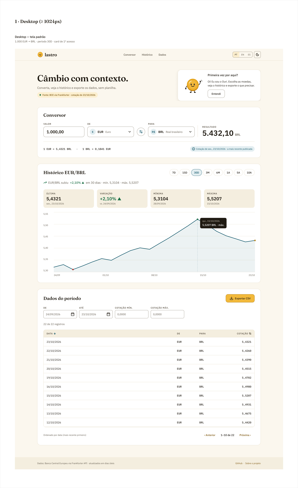

# Figma — Lastro (Currency Exchange App)

**Arquivo:** https://www.figma.com/design/UiMsVBnNP7hYbxMpcS9Hp9

Acesso: qualquer pessoa com o link pode ver. Para navegar no protótipo, abra a página `02 · Protótipo mid-fi` e clique em **Present**.

## Organização do arquivo

O plano Starter do Figma permite até 3 páginas, por isso o arquivo está dividido em 3 páginas, com seções dentro de cada uma.

| Página | Conteúdo |
|---|---|
| `01 · Wireframe low-fi` | Wireframe em escala de cinza: **Desktop 1440**, **Mobile 390** e **Estados (low-fi)**: skeleton, splash, erro de API, filtros sem resultado e período sem cotações. Seções numeradas: ① Conversor ② Histórico ③ Dados |
| `02 · Protótipo mid-fi` | Seção **Desktop · 1440**: tela padrão com tokens e componentes reais. Seção **Mobile · 390 (adaptação)**: tela padrão, seletor de moeda em tela cheia e bottom sheet de filtros/ordenação. Seção **Estados**: splash, loading, erro, ausência de dados, período sem cotações, entrada inválida, toast de CSV e offline, no desktop e no mobile |
| `03 · Componentes & Tokens` | Ícones (Lucide), marca, mascote Ouri (6 poses, component set), Button (Primary/Secondary/Ghost/Disabled), Field/Amount (Default/Error), Currency Select, Swap Button, Filter Field, Period Chip, Source Badge, KPI Card, Table Header/Row, Record Card (mobile), Skeleton, Toast, Header Desktop/Mobile |

**Tokens:** a coleção de variáveis `Lastro / Cor` espelha `branding/tokens.css` (modo Light; o plano Starter só permite 1 modo). Também há 12 text styles (Fraunces, IBM Plex Sans e IBM Plex Mono) e 2 effect styles (`Shadow/md`, `Shadow/lg`).

## Checklist do briefing (cartão 2)

- [x] Wireframe de baixa fidelidade (página 01)
- [x] Protótipo de média fidelidade (página 02)
- [x] Versão desktop (1440, container 1200)
- [x] Proposta de adaptação mobile (390: conversor empilhado, períodos com rolagem horizontal, tabela em cartões, filtros em bottom sheet, CSV sticky, seletor de moeda em tela cheia)
- [x] Estados de **loading**, **erro** e **ausência de dados**: low-fi na página 01; mid-fi na seção "Estados" da página 02 (ver nota abaixo)

## Fluxos de protótipo (página 02)

| Origem | Interação | Destino |
|---|---|---|
| Splash desktop / mobile | Após 1,2 s | Tela padrão |
| Exportar CSV | Clique | Tela com toast "Pronto! N registros exportados." |
| Toast → fechar | Clique | Tela padrão |
| Mobile · "Filtros (2)" | Clique | Bottom sheet de filtros |
| Bottom sheet · Fechar / Aplicar | Clique | Tela padrão mobile |
| Mobile · seletor "DE" | Clique | Seletor de moeda em tela cheia |
| Seletor · Fechar | Clique | Tela padrão mobile |
| Erro · "Tentar de novo" | Clique | Tela padrão |
| Vazio · "Limpar filtros" | Clique | Tela padrão |

## Nota de geração

As páginas 01 e 03 e as seções Desktop e Mobile da página 02 foram geradas via Figma MCP (Claude Code), a partir de `branding/wireframes/wireframes.md`, `branding/tokens.css` e `branding/mascot/*.svg`. A geração parou no limite de chamadas MCP do plano Starter. A seção **Estados** mid-fi e os **links de protótipo** saem do plugin local `branding/_src/figma-plugin/`:

1. Abra o arquivo no **Figma Desktop**.
2. Vá em *Plugins → Development → Import plugin from manifest…* e escolha `branding/_src/figma-plugin/manifest.json`.
3. Rode *Plugins → Development → Lastro — Estados e Protótipo*. O plugin cria a seção Estados, liga os fluxos e corrige a opacidade do scrim do bottom sheet. Ele não faz nada se a seção já existir.

Dois plugins locais complementares, importados do mesmo jeito:

- `branding/_src/figma-plugin-organize/`, **Lastro — Organizar páginas**: organiza as páginas 01 e 02 em seções numeradas, com grade e legenda por tela.
- `branding/_src/figma-plugin-fix-scale/`, **Lastro — Corrigir escala e frames**: reescala as cópias do Ouri, da moeda e do logo com `rescale()`, para que traços e formas diminuam na mesma proporção, e confere a largura das telas (Desktop 1440, Mobile 390).

Os três plugins já rodaram no arquivo (28/10/2026).

## Evidências

Capturas exportadas do Figma:

| Seção | Imagem |
|---|---|
| Wireframe low-fi (desktop, mobile e estados) | [`img/figma-lowfi.png`](img/figma-lowfi.png) |
| Mid-fi · Desktop | [`img/figma-midfi-desktop.png`](img/figma-midfi-desktop.png) |
| Mid-fi · Mobile (adaptação) | [`img/figma-midfi-mobile.png`](img/figma-midfi-mobile.png) |
| Estados · Desktop | [`img/figma-estados-desktop.png`](img/figma-estados-desktop.png) |
| Estados · Mobile | [`img/figma-estados-mobile.png`](img/figma-estados-mobile.png) |
| Componentes & Tokens | [`img/figma-componentes.png`](img/figma-componentes.png) |

